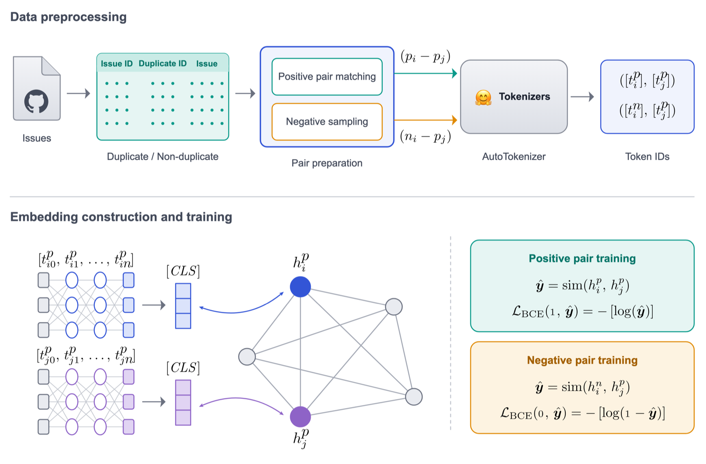

<div align="center">

<h1>Graph Enhanced Transformer for Semi-Supervised Duplicate Bug Report Detection</h1>

**Course project · CS 588, Bilkent · 2025–26**

Emirhan Koç, [Hüseyin Karaca](https://hkaraca.com/), Kerem Bayramoğlu, Hasan Erkin Ünlü, Rabia Ela Ünlü<br>
Bilkent University

[Paper](https://hkaraca.com/graph-enhanced-dbd/assets/paper.pdf) ·
[Project page](https://hkaraca.com/graph-enhanced-dbd/) ·
[Slides](https://hkaraca.com/assets/pdf/graph-enhanced-dbd-slides.pdf) ·
[Reproducibility](https://colab.research.google.com/drive/1zmkY9WIJXK6_2CytcZt5yTbcehKXdtST) ·
[Checkpoints](https://drive.google.com/drive/folders/1AX1-1KC_cgwCqo-A4ecfxoHQWVfm-yV1?usp=sharing)

</div>

This is a semi-supervised duplicate bug report detector. It places every report of a corpus in one title-similarity graph and trains a Siamese transformer through a two-layer GCN, so labelled pairs also shape the unlabelled reports. On Mozilla Thunderbird it reaches F1 0.957, tying BERT, RoBERTa and DistilBERT, and it leads Eclipse recall at 0.935, for 10–12 % extra training time. This repository holds the code of our CS 588 term project: the model, four transformer baselines, the data and the checkpoints behind the paper's tables.

<p align="center"></p>
<p align="center"><em>Labelled pairs train the encoder, and every report joins one graph, so supervision reaches unlabelled reports too.</em></p>

## Installation

Experiments ran on one NVIDIA A100 (80 GB); Google Colab GPUs run the same scripts.
<!-- TODO: tested Python / PyTorch / CUDA versions -->

```bash
git clone https://github.com/huseyin-karaca/graph-enhanced-dbd.git && cd graph-enhanced-dbd
pip install -r requirements.txt
python src/download_data.py    # fetches dataset.tar.gz and extracts it to datasets/
```

## Quick start

Train the graph-enhanced model on Thunderbird. Run it from the repository root.

```bash
python src/train_ours.py --dataset_name thunderbird --device gpu --batch_size 64 --epochs 5
# ~1 h on one A100; Table 5 reports test F1 0.957
```

The run writes `best_model.pth`, per-epoch curves and the test confusion matrix to `checkpoints/sbert-gnn_thunderbird/<timestamp>/`.

## Data

Both corpora come from the Eclipse and Mozilla defect tracking dataset ([Lamkanfi et al., MSR 2013](https://doi.org/10.1109/MSR.2013.6624028)). `src/download_data.py` places the preprocessed files as:

```text
datasets/
├── eclipse/        # 68,124 reports, 87,224 labelled pairs
│   ├── tokenized_pairs_train_<model>_50000.csv
│   ├── graph_adj.npz              # title-similarity graph over all reports
│   └── graph_adj_node_ids.npy     # issue ID of each graph node
└── thunderbird/    # 26,040 reports, 53,156 labelled pairs
```

There is one tokenized CSV per encoder (`bert-base-uncased`, `roberta-base`, `distilbert-base-uncased`, `codebert-base`). Each row is a report pair with token IDs, attention masks and a 0/1 duplicate label.

## Reproducing the paper

Every row of Tables 4 and 5 is one training run. Swap `--dataset_name eclipse` for `thunderbird` to get the second column group.

```bash
# Table 5, "Ours"
python src/train_ours.py --dataset_name eclipse --device gpu --batch_size 64 --epochs 5

# Table 5, baselines: pass the encoder from the table below
python src/train_baselines.py --dataset_name eclipse --device gpu --batch_size 64 --epochs 5 \
    --model_name roberta-base
```

| Model | `--model_name` | Eclipse P / R / F1 | Thunderbird P / R / F1 | min/epoch (Ecl. · Thb.) |
|---|---|---|---|---|
| BERT | `bert-base-uncased` | 0.921 / 0.933 / 0.927 | 0.953 / 0.961 / 0.957 | 16.2 · 10.1 |
| RoBERTa | `roberta-base` | 0.918 / 0.930 / 0.924 | 0.946 / 0.968 / 0.957 | 16.3 · 10.2 |
| DistilBERT | `distilbert-base-uncased` | 0.936 / 0.921 / 0.929 | 0.950 / 0.965 / 0.957 | 15.9 · 9.8 |
| CodeBERT | `microsoft/codebert-base` | 0.920 / 0.928 / 0.924 | 0.902 / 0.930 / 0.916 | 16.5 · 10.3 |
| **Ours** | (`train_ours.py`) | **0.913 / 0.935 / 0.924** | **0.949 / 0.966 / 0.957** | **18.1 · 11.1** |

Test-pair scores and minutes per epoch on one A100 (80 GB). Both scripts split the pairs 60/20/20 at random on each run and pick the decision threshold on the validation split. Baselines also write `test_results.txt` to their run folder.

`python figures/site_figures.py` redraws the figures and tables in `notes/project-report.md`, the longer project write-up.

## Repository layout

```text
src/
├── train_ours.py        # Siamese transformer + GCN (the proposed model)
├── train_baselines.py   # Siamese transformer baselines
├── gnn.py               # two-layer GCN and graph normalisation
├── sbert.py             # shared encoder with a 128-d projection head
├── dataset.py           # tokenized pair loader
└── download_data.py     # dataset download and extraction
docs/                    # project page, served at hkaraca.com/graph-enhanced-dbd
figures/                 # overview figure source and notes figures
notes/                   # extended project report
```

## License

Code: [Apache 2.0](LICENSE). Redistributions and derivative works must keep the [NOTICE](NOTICE) file, which credits the authors and the paper. Work that builds on this code or method should cite the paper. The Eclipse and Mozilla data keep their original terms.

## Acknowledgements

Built on [Hugging Face Transformers](https://github.com/huggingface/transformers) and [PyTorch Geometric](https://github.com/pyg-team/pytorch_geometric), with data from the [Eclipse and Mozilla defect tracking dataset](https://doi.org/10.1109/MSR.2013.6624028).
